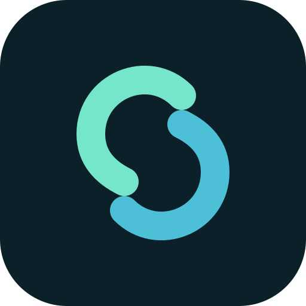

# UserNet

<p align="center"></p>

UserNet — клиент коммерческой сети Userlay. Приложение управляет подпиской и подключением, а на Android умеет передавать соединение через звонковый транспорт Zorin Fabric. Политики маршрутизации, DNS и VPN обрабатывает Mihomo.

**Состояние:** разработка и проверка на реальном телефоне. В длительных проверках звонкового транспорта наблюдались ошибки передачи и переподключения; стабильный массовый выпуск требует повторяемых тестов на разных сетях. Доступность при любых ограничениях оператора не гарантируется.

## Начало работы

1. Установите подписанный клиент UserNet из доверенного канала.
2. Импортируйте свою ссылку подписки и откройте **Аккаунт → Подключить текущую подписку**.
3. Для первой привязки нужна сеть, в которой доступен API аккаунта. Сохранённая привязка позволяет использовать звонковый транспорт позже.
4. В настройках транспорта выберите **Автоматически**, **Прямой** или **Через звонок**. Последний режим не переключается на прямой маршрут при ошибке звонка.
5. Запустите VPN на главном экране. Подключение транспорта само по себе ещё не означает, что VPN включён.

Контрольный звонок выдаёт рабочую сессию и завершается. Транспортный звонок переносит данные; его готовность проверяется HTTPS-запросом. Индикаторы показывают оба этапа отдельно. Ручной выбор сервиса не заменяется другим незаметно; недоступные сервисы отключены.

## Документация

- [Архитектура и границы доверия](docs/USERNET.md)
- [Аккаунт и первая привязка](docs/account-bootstrap.md)
- [Проверка мобильного соединения](docs/usernet/mobile-connectivity.md)
- [Сборка и выпуск](docs/releasing.md)
- [Условия готовности релиза](docs/release-readiness.md)
- [Переключение Wi-Fi и мобильной сети](docs/usernet/network-handover.md)
- [Участие в разработке](.github/CONTRIBUTING.md)
- [Сообщение об уязвимости](.github/SECURITY.md)

## Разработка

Текущий Android-клиент проверяется с Flutter 3.41.6. Версии Android SDK, Gradle и Java согласованы в конфигурации проекта. Для сборки звонкового адаптера нужен соседний checkout `vconnect` либо переменная `VCONNECT_DIR`; серверный creator и Android relay должны использовать совместимый протокол.

```sh
flutter pub get
flutter analyze --no-fatal-infos
flutter test --no-pub test
VCONNECT_DIR=/path/to/vconnect scripts/build-usernet-relay.sh
USERNET_FLUTTER_BIN=/path/to/flutter scripts/build-usernet-release.sh stable
```

Ключ подписи хранится вне репозитория. Точный порядок и требования к выпуску описаны в документации. Android — основная проверяемая платформа; поддержка звонкового транспорта на Windows пока не реализована.

## Авторство и лицензия

Разработка UserNet: **Ivan Zorin (localzet)**, [www.localzet.com](https://www.localzet.com), creator@localzet.com. Copyright © 2018–2026 Localzet Group. Userlay — сообщество и проект сети UserNet.

Клиент основан на FlClashX / FlClash и Mihomo. Исходные уведомления об авторстве сохраняются. Условия клиента — **GPL-3.0-or-later**, см. [LICENSE](LICENSE); условия сторонних компонентов определяются их лицензиями. Закрытый статус репозитория не отменяет обязательства при распространении GPL-кода.
